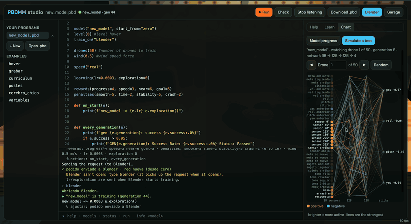

<div align="center">

# Neural Drone Forge

**Build the drone. Train its brain. Watch it learn to fly.**

A drone simulator in the browser where **the AI is the star**: you build the drone part by part, teach it to fly
with reinforcement learning *on your own computer*, and you can **watch it train in Blender** — dozens of drones
trying at once while the neural network lights up as it learns.

[Español](README.md) · [Play](#play-in-2-minutes) · [Modes](#two-ways-to-play) · [How it learns](#how-the-ai-learns) · [PBDMM](#pbdmm-the-language-for-building-ais) · [Roadmap](docs/ROADMAP.md)


*25 drones learning at once in Blender's Drone Lab: each camera cone turns from red to green when the shot is good.
[Watch the full minute (MP4)](docs/media/blender_entrenamiento.mp4).*

*Version 1.0 · Spanish and English · 100% local (your computer trains, nothing goes online) · MIT*

</div>

---

## What it is

You start in a garage with $150. You buy real parts (ESP32, STM32, ExpressLRS, brushless motors…), **3D-print the
frame**, assemble it, wire it to the real pins (get it wrong and **it burns**), flash the firmware, check that every
motor spins the right way and strap it to the bench for the first test. Then clients start asking for videos: Doña
Marta's house, the windy farm, a restaurant full of poles.

And the drone doesn't fly those jobs by magic: **you have to train it**. Every drone has its own neural network that
learns with PPO (reinforcement learning) from the rewards and penalties you choose. What it learns depends on its
physics (weight, motors, propellers), on the mission and on how you train it.

| | |
|---|---|
|  |  |
| **Hangar.** Several drones, each with its purpose and **its own AI**. | **Workbench.** Real ESP32 / STM32 pins: shorts, reversed polarity, TX to TX… |
|  |  |
| **Motors.** The order and spin direction Betaflight expects, props off. | **Jobs.** Shots along a route, graded on framing, pace and stability; `.webm` video. |

## The demo



*Developer mode: write a model in PBDMM, train it in Blender, watch its neural network live and replay its best
attempt. [Watch the full demo (MP4, 4½ min)](docs/media/demo_estudio.mp4).*

## Two ways to play

| **Normal mode: the campaign** | **Developer mode: build the AI with code** |
|---|---|
| Garage → shop → workbench → jobs. Earn money and reputation, unlock parts and train each drone's AI in the **AI Lab** (rewards and penalties from 0 to 10, in the background or in Blender). | Everything unlocked and two drones ready. You write **how** each model is trained in **PBDMM**, a Python-looking language, in an IDE with a terminal, autocomplete, help, lessons and the **live neural network** of any of the training drones. |

Every model can be checked anytime with **Model progress** (its first, worst, best and latest attempts) and
**Simulate a test** (a fresh random test like the ones it trains on, flown by its latest generation): the route, the
neural network at every instant, charts and three cameras.

## Play in 2 minutes

You need **Python 3.11+** (tested with 3.13) and a browser with WebGL (Chrome, Safari, Firefox). Blender is optional
(tested with 5.2): it lets you *watch* the training.

```bash
git clone https://github.com/Sagaz0501/neural-drone-forge.git
cd neural-drone-forge
python3 -m venv .venv && source .venv/bin/activate
pip install -r requirements.txt
python scripts/jugar.py          # opens http://localhost:8765/app/
```

The first time, the game asks which language you want (Español / English) and copies the published AI
(`models/publico/`, generation 3560) as the base model, so you can fly from minute one.

## How the AI learns

```
   38 sensors                     your neural network               4 sticks
 ┌──────────────┐        ┌─────────────────────────────┐       ┌───────────┐
 │ attitude     │        │  38 → 128 → 128 → 4         │       │ throttle  │
 │ velocity     │ ─────▶ │  (or the size you give it)  │ ────▶ │ roll      │
 │ where the    │        │                             │       │ pitch     │
 │ target is    │        └──────────────▲──────────────┘       │ yaw       │
 │ 10 distances │                       │ PPO nudges weights    └─────┬─────┘
 │ the subject  │                       │ toward what paid most       │
 │ its physics  │               ┌───────┴────────┐                    ▼
 └──────────────┘               │ rewards (+)    │◀──── the simulator: quad physics,
                                │ penalties (−)  │      wind, obstacles
                                └────────────────┘      (Python = JavaScript)
```

1. **Dozens of drones practice at once** with the same brain (a *generation*).
2. Each one earns **rewards** (filming well, facing the subject, getting closer) and pays **penalties** (crashing, shaking).
3. **PPO** moves the network's weights a little toward whatever paid better than expected.
4. Repeat thousands of times. The success curve climbs, and in Blender you see it go from falling to flying.

The simulator exists **twice and does exactly the same math**: in Python (where it trains) and in JavaScript (where
you play). A test checks it number by number, so the model you trained flies the same in the game.

## PBDMM: the language for building AIs

*Python Base Dron Model Maker.* A program describes **how a model is trained**:

```python
NAME = "camarografo"
modelo(NAME, desde="colibri")        # start from another model of yours that already flies
mision("grabar")                     # what it has to learn: filming
dron("azar")                         # which physics: "azar" = learn to fly any drone
entrenar_en("blender")               # or "fondo": in the background

premios(grabar=6, mirar=4)           # rewards, 0 to 10 · 4 = normal
castigos(chocar=3, sacudidas=6)      # penalties

def cada_generacion(e):              # the game calls it while training
    print(f"gen {e.generacion}: success {e.exito:.0%}")
    if e.exito >= 0.9:
        detener()                    # stop
```

Variables, lists, dicts, `if/for/def`, comprehensions, f-strings… **no `import`, no `while`**: the browser interprets
it, so a program someone sends you can't touch your computer. Autocomplete knows your drones and models; errors point
at the line with suggestions. Terminal: `correr` (run), `estado`, `modelos`, `info`, `cargar <model> <drone>` (upload
the latest generation to a drone), `simular`, `avance`, `blender`. Language docs (Spanish for now):
[docs/pbdmm/](docs/pbdmm/README.md): tutorial, reference, grammar, library, errors and the [training API](docs/PBDMM.md).

## Watch it train in Blender

The **Drone Lab** (`blender/drone_lab.py`) opens `blender/laboratorio.blend`: the drones flying the mission, the camera
cone that turns green when the shot is good, the network of the drone you're watching and the success curves. Blender
only *shows*: training is driven from the game. Its **Video mode** hides Blender's menus for recording. Without
Blender, models train **in the background** (up to 2 at once).

## Tests

```bash
python -m pytest -q
python game/make_fixture.py && node game/test_sim.mjs   # JS simulator == Python simulator
node app/test_parts.mjs && node app/test_banco.mjs && node app/test_pbdmm.mjs && node app/test_modulos.mjs && node app/test_i18n.mjs
```

They run on every push ([GitHub Actions](.github/workflows/pruebas.yml)).

## Credits

Made by **Santiago Bernal** ([@Sagaz0501](https://github.com/Sagaz0501)), embedded systems engineer, with
[Claude Code](https://claude.com/claude-code). Three.js for 3D, stable-baselines3 + PyTorch for learning, Gymnasium
for the environment, Blender for the lab. License: [MIT](LICENSE).
