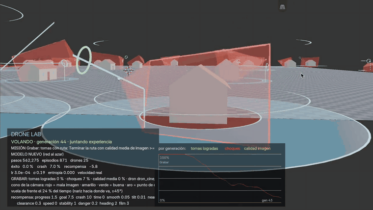
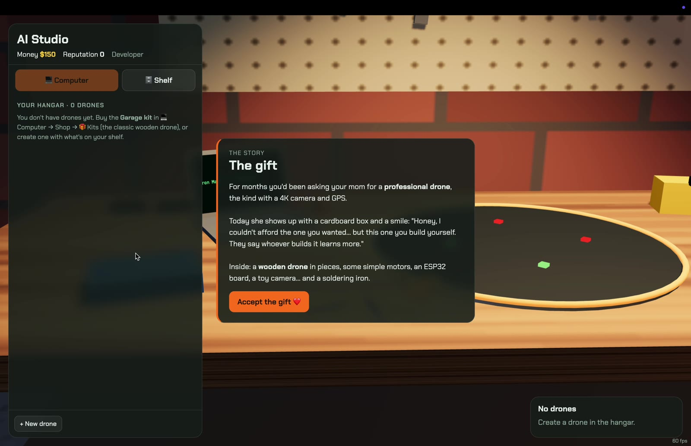
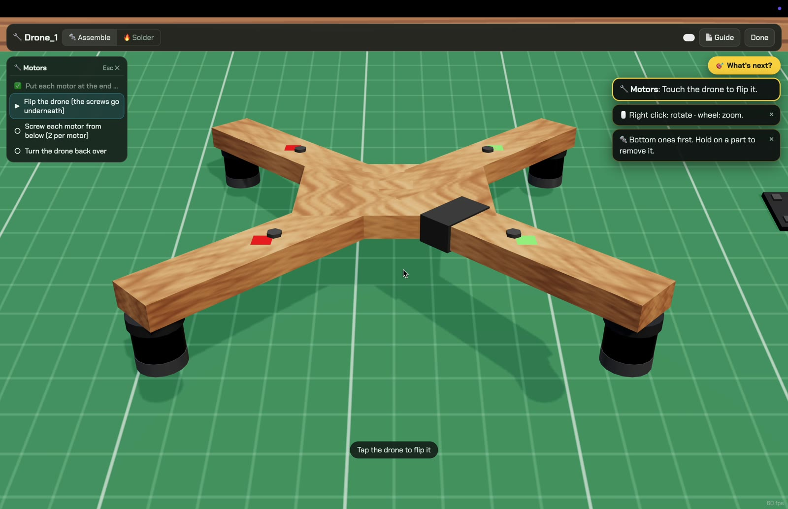
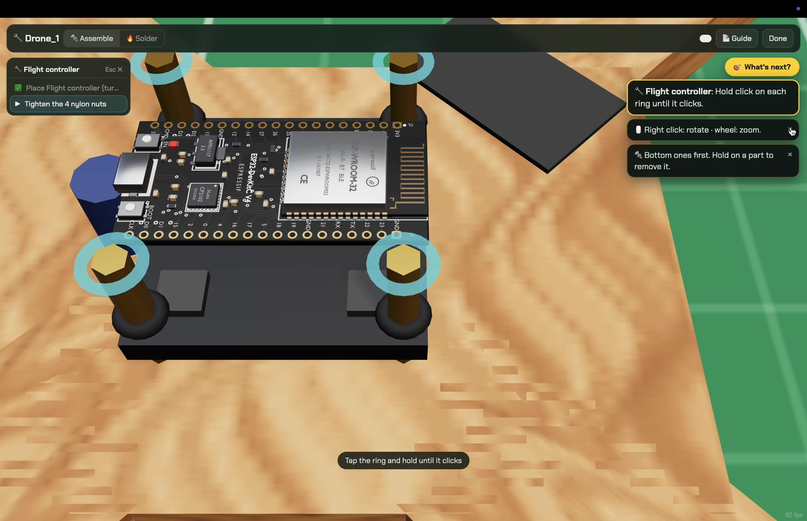
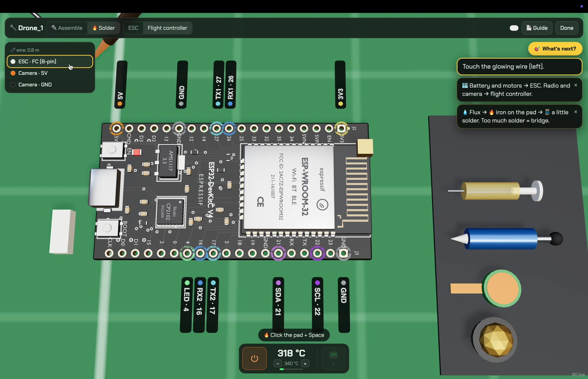
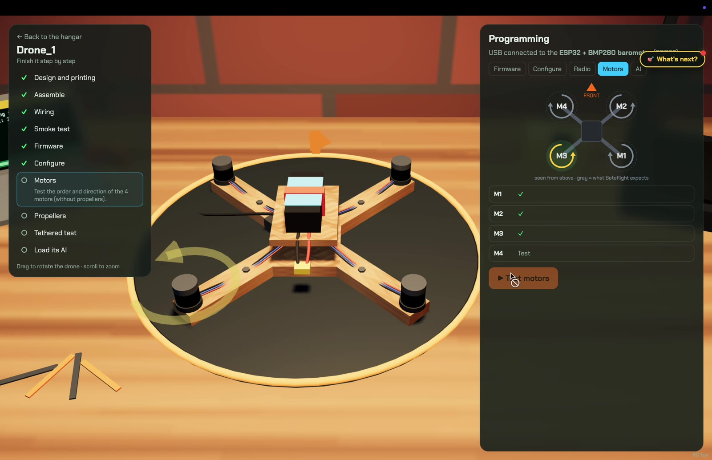
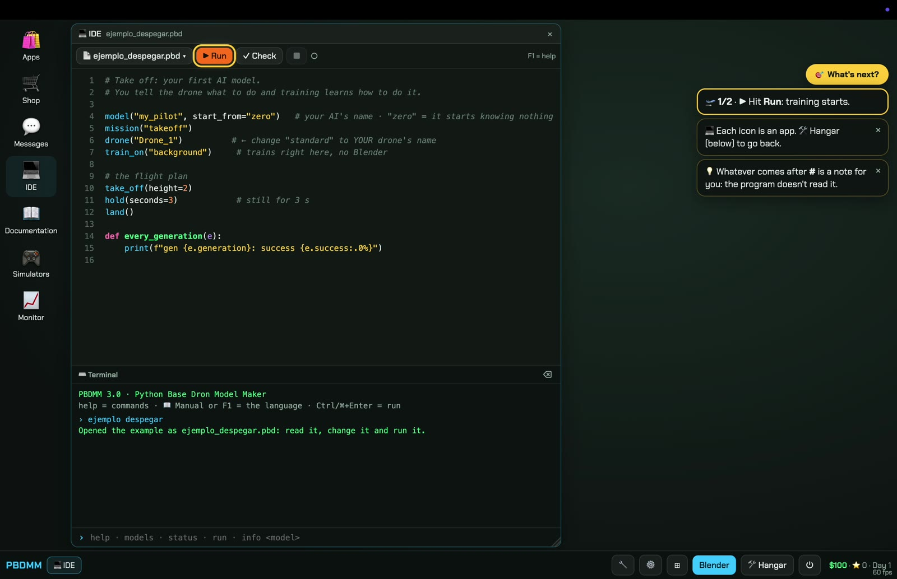
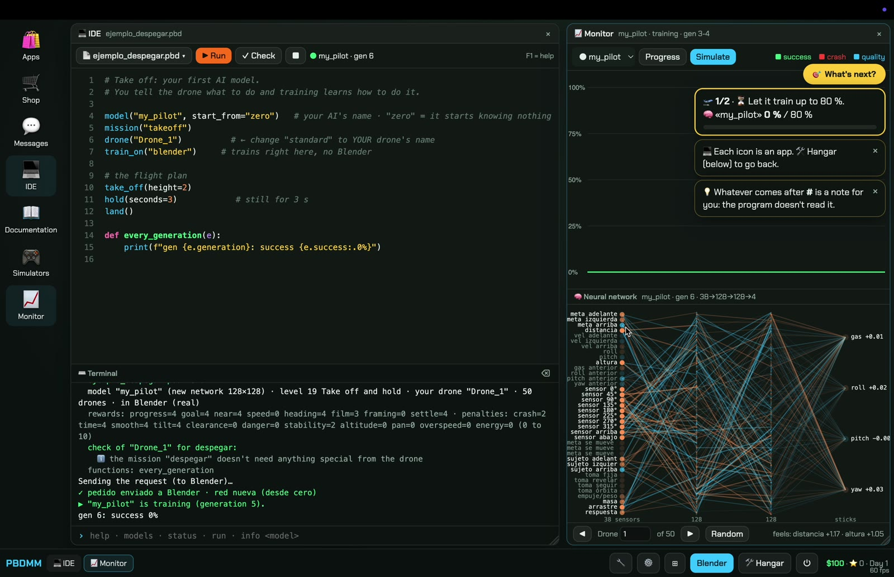
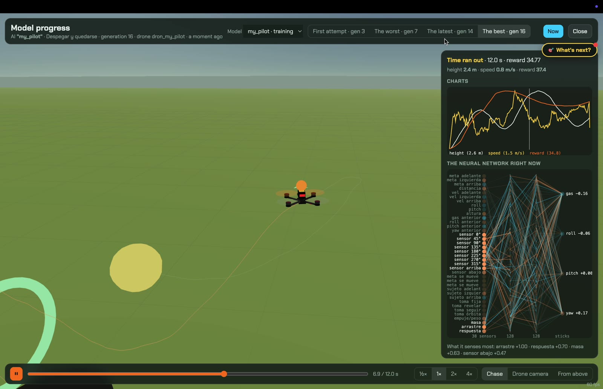
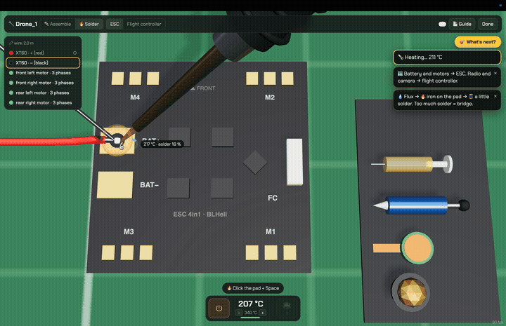

<div align="center">

# Neural Drone Forge

**Build the drone. Train its brain. Watch it learn to fly.**

A desktop game where **the AI is the star**: you build a drone piece by piece (screw it together, solder it, flash
the firmware) and then teach it to fly with reinforcement learning *on your own computer*, step by step: first to
take off, then to reach a point, follow a line, take photos and film. And you can **watch the training in
Blender**: 50 drones trying at once and the neural network lighting up as it learns.

[🌐 Website](https://sagaz0501.github.io/neural-drone-forge/?lang=en) · [Español](README.md) · [Download and play](#download-and-play) · [How to play](#how-to-play) · [Step-by-step training](#step-by-step-training-e1e12) · [PBDMM](#pbdmm-the-language-for-building-ais) · [Roadmap](docs/ROADMAP.md)



*25 drones learning at once in Blender's Drone Lab: each camera cone goes from red to green when the shot is good.
[Watch the full minute (MP4)](docs/media/blender_entrenamiento.mp4).*

*v3.0 · desktop app (Mac, Windows, Linux) · English and Spanish · 100 % local: your computer trains, nothing goes online · MIT*

</div>

---

## Now it's an app

Since **v3.0**, Neural Drone Forge runs in **its own window**, like any game: no browser, no address bar, 60 fps on
the GPU. The app starts the game server (the one that trains the AI) by itself and shuts it down when you quit. Same
graphics as always, now as a real app.

> **For now** you download the code and open it with one command (below, 5 minutes).
> **Coming next:** a `.dmg` installer for Mac and an `.exe` for Windows: download, double-click, play.

## What it is

Your mom gives you a wooden drone kit: an ESP32, recycled motors, a toy camera and a soldering iron. You build it on
a **3D workbench** (cut the tape on the boxes, mount each part, screw until it clicks, **solder** every wire with
flux and solder), flash it, test the motors and tie it to the table for its first flight. Then you turn on the
computer, buy the programs and **train its first AI**. Once it learns to reach a point and look, your first client
writes to you: Doña Marta wants a photo of her house.

And the drone doesn't just take it: **you have to train it**. Every drone has its own neural network that learns
with PPO (reinforcement learning) from the rewards and penalties you choose. What it learns depends on its physics
(weight, motors, props), the scenario and how you train it.

| | |
|---|---|
|  |  |
| **Mom's gift.** That's how it starts: $150 and a wooden drone in boxes. | **The workbench.** Each part with its own procedure: flip the drone, screws from below, standoffs… |
|  |  |
| **Screwing.** Hold the click until it clicks; keep going and you strip the thread. | **Real soldering.** Station, iron, flux and solder. Cold joints and bridges the bench won't tell you about. |
|  |  |
| **Motor test.** One button, each motor ✓ or ✗, and the fix it needs: the order, the direction or solder again. | **Your first AI.** The tutorial points at the line to change (👉) and you train it with ▶ Run. |
|  |  |
| **Watch it learn.** The success curve and the neural network of the drone you're watching, live. | **Model progress.** Its best and worst attempt, with the charts and the network at every instant. |



## Download and play

You need **Python 3.11+** (tested with 3.13) and **Node.js 18+** (for the app). **Blender** is optional (tested with
5.2): it lets you *watch* the training in 3D, and the game recommends it.

```bash
# 1. Get the game
git clone https://github.com/Sagaz0501/neural-drone-forge.git
cd neural-drone-forge

# 2. The AI engine (Python: the simulator, PPO, the server)
python3 -m venv .venv
source .venv/bin/activate          # Windows: .venv\Scripts\activate
pip install -r requirements.txt

# 3. The app
cd desktop
npm install
npm start                          # opens Neural Drone Forge in its window
```

After that it's just `cd desktop && npm start`. `npm start -- --freestyle` opens freestyle directly.

<details>
<summary>Prefer the browser?</summary>

```bash
python scripts/jugar.py            # opens http://localhost:8765/app/ (Chrome, Safari or Firefox with WebGL)
```

Saves in the app and in the browser are kept separately.
</details>

The [player guide](docs/GUIA.md) (in Spanish) explains everything step by step.

## How to play

1. **The gift.** Name your drone and build it on the workbench: mount, screw, solder. The computer stays off until
   the drone flies.
2. **The bench.** Smoke test (if something is wrong, it burns), firmware, configuration, motors, props and the test
   tied to the table.
3. **The computer.** The center of the game: buy the programs you need (Messages, the AI Simulator or the IDE), the
   parts shop, your finances, your videos.
4. **Your first AI.** You train it in two steps: 🛫 **take off and hold still** and 📍 **go to a point looking where you
   ask**. Each step is passed with an exam (80 % without noise).
5. **Level 0.** Doña Marta writes to you: a photo of her house. From then on, clients text your phone (photos,
   inspections and videos from ★ to ★★★★), you earn money and reputation, buy better parts and new scenarios, and
   your AI drones do the jobs on their own at the end of the day.

### Two ways to play

| **Normal mode: the campaign** | **Developer mode: build the AI with code** |
|---|---|
| Train each drone's AI in the **Lab**: pick the scenario and the rewards and penalties from 0 to 10, in the background or in Blender. | Write **how** each model is trained in **PBDMM**, a Python-like language, in an IDE with a terminal, autocomplete, help and the **live neural network**. The tutorial walks you through your first program. |

## Step-by-step training (E1–E12)

Teaching everything at once to an AI that knows nothing is slow. Like a person, it's better to teach it **bit by
bit**: first to fly, then to arrive, then to take photos. Each **scenario** is a training ground with its exam:

| | Scenario | What it learns |
|---|---|---|
| E1 | 🛫 Take off and hold | Climb to a random height and hold still for 3 s (free) |
| E2 | 📍 Go to a point | Reach a random point and hold, looking where it's told (free) |
| E3 | 〰️ Follow a line | Follow a curved line without leaving it |
| E4 | 📷 Photo | The right moment and the framing: the house in the center |
| E5 | 🖼️ Photo set | Several photos in a row around the subject |
| E6 | 🎬 Video on a path | Follow the shot (static, orbit, reveal) without losing the house |
| E7 – E9 | 🏛️ 💨 🏮 | Dodge columns, film in the wind, film between poles |
| E10 – E12 | 📦 🏁 🐇 | Deliveries, races and chases |

- **Exam 🎓:** 20 fixed attempts with the network as is (without the exploration noise). 80 % or more: passed.
- **Each scenario starts from what it already knows:** the game suggests starting from the model that passed the
  previous one, and 20 % of the attempts **review** what it learned so it doesn't forget.
- **⭐ Base model:** the model that passes take off, go to a point, follow a line, photo and video is your base model:
  the starting point for all the others.

## How the AI learns

1. **50 drones practice at once** with the same brain (a *generation*).
2. Each one earns **rewards** (arriving, holding still, framing) and pays **penalties** (crashing, shaking).
3. **PPO** nudges the network's weights toward whatever paid more than expected.
4. Repeat thousands of times. The success curve climbs, and in Blender you see it go from falling to flying.

The simulator exists **twice and does exactly the same math**: in Python (where it trains) and in JavaScript (where
you play). A test checks it number by number. That's why the model you trained flies the same in the game.

## PBDMM: the language for building AIs

*Python Base Drone Model Maker.* A program describes **how** a model is trained. The tutorial's first one:

```python
model("my_pilot", start_from="zero")   # your AI's name · "zero" = it starts knowing nothing
mission("takeoff")
drone("Chispa")                        # ← YOUR drone's name
train_on("blender")                    # or "background": no window

# the flight plan
take_off(height=2)
hold(seconds=3)                        # still for 3 s
land()

def every_generation(e):               # the game calls it while training
    print(f"gen {e.generation}: success {e.success:.0%}")
```

Variables, lists, dicts, `if/for/def`, comprehensions, f-strings… **no `import` or `while`**: the game interprets
it, so a program someone sends you can't touch your computer. Language docs: [docs/pbdmm/](docs/pbdmm/README.md).

## Status

**Version 3.0** ([releases](https://github.com/Sagaz0501/neural-drone-forge/releases)): the desktop app, the full
tutorial (gift → workbench → bench → computer → first AI in two steps), games that start from zero, 12 training
scenarios with exams, review and a ⭐ base model, the business (clients, repeatable jobs, the fleet), 3 campaign jobs,
freestyle with your controller, developer mode with PBDMM 3, Blender as the training screen. English and Spanish.

**Coming next:** installers (`.dmg` and `.exe`), saves stored in files, polishing what's there, then Act 2 of the
story. See the [Master plan](docs/PLAN_MAESTRO.md) and the [Roadmap](docs/ROADMAP.md) (in Spanish).

## Credits

Made by **Santiago Bernal** ([@Sagaz0501](https://github.com/Sagaz0501)), embedded systems engineer, with
[Claude Code](https://claude.com/claude-code). Three.js for 3D, Electron for the app, stable-baselines3 + PyTorch for
learning, Gymnasium for the environment, Blender for the lab.

[MIT](LICENSE) license.
