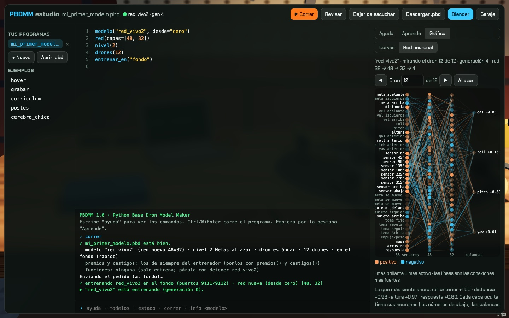
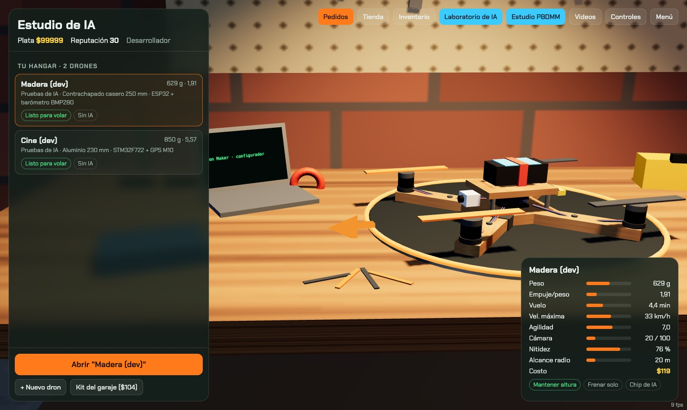
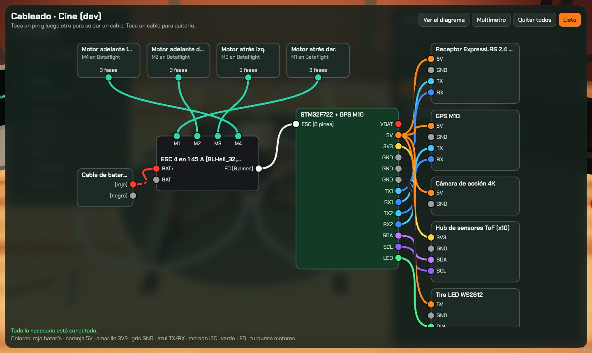
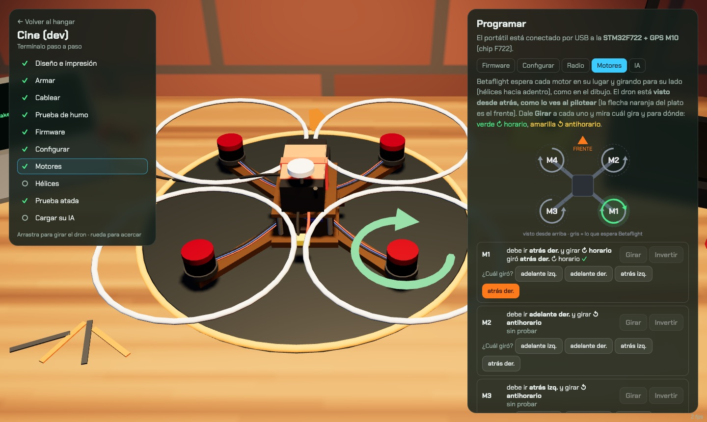
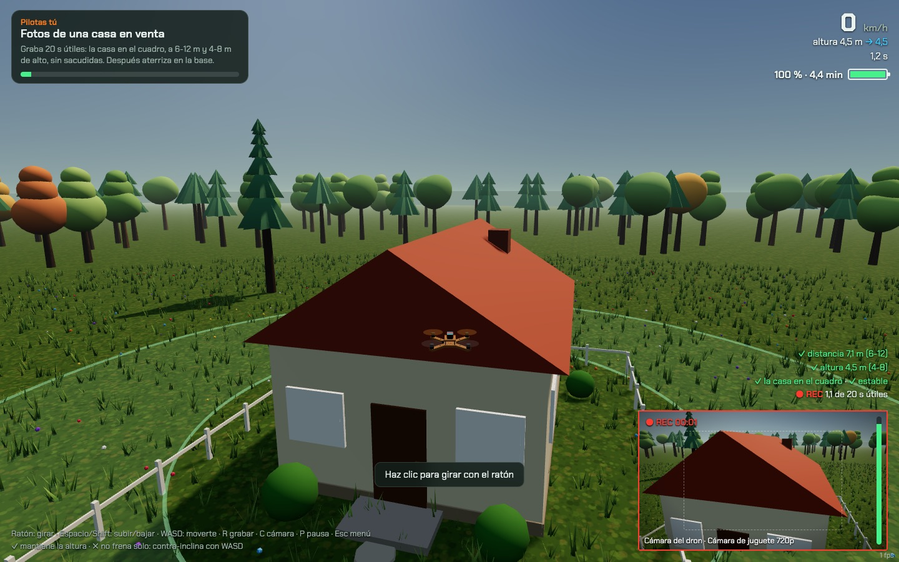
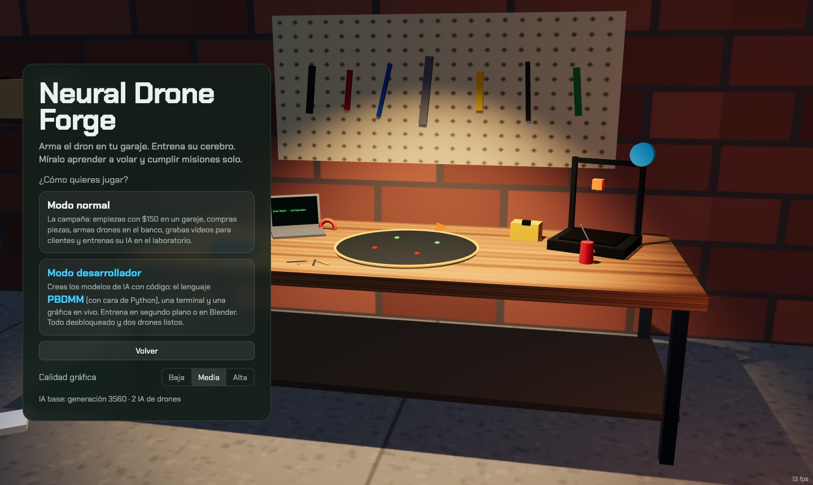

<div align="center">

# Neural Drone Forge

**Arma el dron. Entrena su cerebro. Míralo aprender a volar.**

Un simulador de drones en el navegador donde **la protagonista es la IA**: construyes el dron pieza por pieza,
le enseñas a volar con aprendizaje por refuerzo *en tu propia computadora*, y puedes **ver el entrenamiento en
Blender**: 50 drones probando a la vez y la red neuronal encendiéndose mientras aprende.

[Jugar](#jugar-en-2-minutos) · [Modos](#dos-formas-de-jugar) · [Cómo aprende](#cómo-aprende-la-ia) · [PBDMM](#pbdmm-el-lenguaje-para-crear-ias) · [Roadmap](docs/ROADMAP.md) · [Documentación](#documentación)



*Demo jugable · en español · 100 % local (tu compu entrena, nada sale a internet) · MIT*

</div>

---

## Qué es

Empiezas en un garaje con $150. Compras piezas reales (ESP32, STM32, ExpressLRS, motores brushless…),
**imprimes el chasis en 3D**, lo armas, conectas los cables a los pines de verdad (si te equivocas, **se quema**),
flasheas el firmware, pruebas que los motores giren para el lado correcto y lo amarras a la mesa para la
primera prueba. Después, los clientes te piden videos: la casa de Doña Marta, la finca con viento, un
restaurante lleno de postes.

Y el dron no los vuela solo porque sí: **tienes que entrenarlo**. Cada dron tiene su propia red neuronal que
aprende con PPO (aprendizaje por refuerzo) según los premios y castigos que tú decides. Lo que aprende depende
de su física (peso, motores, hélices), de la misión y de cómo lo entrenas.

| | |
|---|---|
|  |  |
| **Hangar.** Varios drones, cada uno con su propósito y **su propia IA**. | **Banco de armado.** Pines reales del ESP32 / STM32: corto, polaridad invertida, TX con TX… |
|  |  |
| **Motores.** El orden y el sentido de giro que espera Betaflight, sin hélices. | **Pedidos.** Tomas con ruta, calificadas por encuadre, ritmo y estabilidad; video `.webm`. |

## Dos formas de jugar



| **Modo normal: la campaña** | **Modo desarrollador: crea la IA con código** |
|---|---|
| Garaje → tienda → banco de armado → pedidos. Ganas plata y reputación, desbloqueas piezas y entrenas la IA de cada dron en el **Laboratorio** (premios y castigos de 0 a 10, en segundo plano o en Blender). | Todo desbloqueado y dos drones listos. Escribes **cómo** se entrena cada modelo en **PBDMM**, un lenguaje con cara de Python, en un IDE con terminal, autocompletado, ayuda, lecciones y la **red neuronal en vivo** de cualquiera de los drones que entrenan. |

Cada modo tiene su herramienta: en el normal no aparece el IDE y en el desarrollador no aparece el Laboratorio.

## Jugar en 2 minutos

Necesitas **Python 3.11+** (probado con 3.13) y un navegador con WebGL (Chrome, Safari, Firefox).
Blender es opcional (probado con 5.2): sirve para *ver* el entrenamiento.

```bash
git clone https://github.com/Sagaz0501/neural-drone-forge.git
cd neural-drone-forge
python3 -m venv .venv && source .venv/bin/activate
pip install -r requirements.txt
python scripts/jugar.py          # abre http://localhost:8765/app/
```

La primera vez se copia la IA publicada (`models/publico/`, generación 3560) como modelo base, para que el juego
tenga con qué volar desde el primer minuto. La [guía del jugador](docs/GUIA.md) explica todo paso a paso.

## Cómo aprende la IA

```
   38 sensores                    tu red neuronal                 4 palancas
 ┌──────────────┐        ┌─────────────────────────────┐       ┌───────────┐
 │ inclinación  │        │  38 → 128 → 128 → 4         │       │ gas       │
 │ velocidad    │ ─────▶ │  (o el tamaño que le des)   │ ────▶ │ roll      │
 │ dónde está   │        │                             │       │ pitch     │
 │ la meta      │        └──────────────▲──────────────┘       │ yaw       │
 │ 10 distancias│                       │ PPO ajusta los pesos  └─────┬─────┘
 │ el sujeto    │                       │ hacia lo que más pagó       │
 │ su física    │               ┌───────┴────────┐                    ▼
 └──────────────┘               │ premios (+)    │◀──── el simulador: física del
                                │ castigos (−)   │      quad, viento, obstáculos
                                └────────────────┘      (Python = JavaScript)
```

1. **50 drones practican a la vez** con el mismo cerebro (una *generación*).
2. Cada uno cobra **premios** (grabar bien, mirar al sujeto, acercarse) y paga **castigos** (chocar, temblar).
3. **PPO** mueve los pesos de la red un poquito hacia lo que dio más premio del esperado.
4. Se repite miles de veces. La curva de éxito sube, y en Blender lo ves pasar de caerse a volar.

El simulador existe **dos veces y hace exactamente las mismas cuentas**: en Python (donde entrena) y en
JavaScript (donde juegas). Una prueba lo verifica número por número. Por eso el modelo que entrenaste vuela
igual en el juego. Más en [cómo funciona por dentro](docs/ARQUITECTURA.md) y en
[redes neuronales desde cero](docs/redes-neuronales.md).

## PBDMM: el lenguaje para crear IAs

*Python Base Dron Model Maker.* Un programa describe **cómo se entrena** un modelo:

```python
NOMBRE = "camarografo"
modelo(NOMBRE, desde="colibri")      # parte de otro modelo tuyo que ya sabe volar
mision("grabar")                     # qué tiene que aprender
dron("azar")                         # con qué física: "azar" = aprende a volar cualquier dron
entrenar_en("blender")               # o "fondo": sin ventana

premios(grabar=6, mirar=4)           # todo de 0 a 10 · 4 = lo normal
castigos(chocar=3, sacudidas=6)

def cada_generacion(e):              # el juego la llama mientras entrena
    print(f"gen {e.generacion}: éxito {e.exito:.0%}")
    if e.exito >= 0.8:
        aprendizaje(lr=0.0001)       # ya casi: ajustes finos
    if e.exito >= 0.9:
        detener()
```

- Variables, listas, diccionarios, `if/for/def`, comprensiones, f-strings… **sin `import` ni `while`**: lo interpreta
  el navegador, así que un programa que te pasen no puede tocar tu compu.
- **Autocompletado** que conoce el juego: `dron(` te ofrece tus drones; `desde=` tus modelos entrenados.
- Errores en español con la línea y sugerencias (*¿quisiste decir "chocar"?*).
- Terminal: `correr`, `estado`, `modelos éxito`, `info`, `volar <modelo>`, `blender`…
- Referencia completa: **[docs/PBDMM.md](docs/PBDMM.md)**.

## Ver el entrenamiento en Blender

```bash
python scripts/jugar.py   # y en el juego: Laboratorio → "Abrir Blender" (o en el Estudio: comando blender)
```

El **Drone Lab** (`blender/drone_lab.py`) abre `blender/laboratorio.blend`: los drones volando en la misión,
el cono de la cámara que se pone verde cuando la toma es buena, la red neuronal del dron que miras y las curvas
de éxito. El juego le manda los pedidos y Blender los toma solo. Sin Blender se entrena en **segundo plano**
(hasta 2 modelos a la vez).

## Estado

**Demo jugable (v0.1).** Lo que hay hoy:

- ✅ Garaje 3D, tienda con piezas reales, inventario y hangar con varios drones.
- ✅ Banco de armado: impresión 3D (formas o tu STL), cableado con pines reales y fallas, prueba de humo,
  firmware, configuración, orden de motores, hélices y prueba atada.
- ✅ 3 pedidos jugables (casa, finca con viento, restaurante entre postes) con tomas calificadas y video.
- ✅ Una IA por dron, entrenable en segundo plano o en Blender; "Que grabe la IA" en cada pedido.
- ✅ Modo desarrollador: Estudio PBDMM con autocompletado, terminal, gráficas y la red neuronal en vivo.
- ✅ **Avance del modelo** (su mejor y su peor intento) y **Simular prueba** (la misma prueba del entrenamiento, con
  la última generación): recorrido, red neuronal, gráficas y cámaras. Pedidos distintos en cada intento.
- ✅ Blender como pantalla del entrenamiento, con **Modo video** para grabar.

Lo que viene (soldar con cautín, más fallas en el banco, mando de PS5, mapas de freestyle y FPV, misiones
que solo la IA puede cumplir, video con varios drones…) está en el **[Roadmap](docs/ROADMAP.md)**.

## Documentación

| | |
|---|---|
| [Guía del jugador](docs/GUIA.md) | Los dos modos, el banco paso a paso, los pedidos, entrenar, controles, problemas comunes |
| [Referencia de PBDMM](docs/PBDMM.md) | Funciones, premios y castigos, `e`, terminal, ejemplos, lecciones |
| [Roadmap](docs/ROADMAP.md) | Qué mejorar, paso a paso, para que la demo sea un juego completo |
| [Arquitectura](docs/ARQUITECTURA.md) | Cómo se conectan el navegador, el servidor, el entrenador y Blender |
| [Plan del juego](docs/PLAN_JUEGO.md) · [Campaña](docs/HISTORIA.md) | La idea original y los capítulos |
| [La base: drone-rl](docs/PROYECTO.md) · [Bitácora](docs/README_drone-rl.md) | El simulador y la IA de donde nace todo |
| [Redes neuronales desde cero](docs/redes-neuronales.md) | La teoría, explicada sin humo |
| [CHANGELOG](CHANGELOG.md) · [CLAUDE.md](CLAUDE.md) | Qué cambió · la guía para trabajar el proyecto con Claude Code |

## Pruebas

```bash
python -m pytest -q                                     # simulador + servidor
python game/make_fixture.py && node game/test_sim.mjs   # el simulador de JS == el de Python
node app/test_parts.mjs && node app/test_banco.mjs && node app/test_pbdmm.mjs
```

Corren solas en cada push ([GitHub Actions](.github/workflows/pruebas.yml)).

## Créditos

Hecho por **Santiago Bernal** ([@Sagaz0501](https://github.com/Sagaz0501)), ingeniero de sistemas embebidos,
con [Claude Code](https://claude.com/claude-code). Three.js para el 3D, stable-baselines3 + PyTorch para el
aprendizaje, Gymnasium para el entorno, Blender para el laboratorio.

Licencia [MIT](LICENSE).
