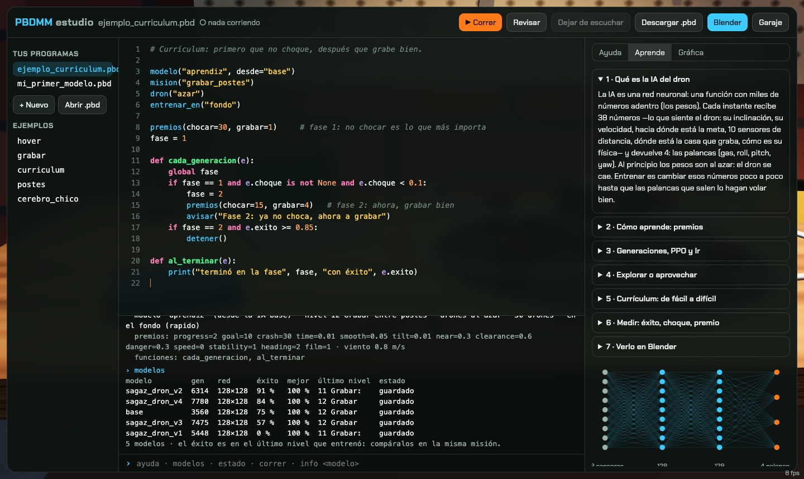

# Dron Maker

**Un juego 3D en el navegador para armar drones de verdad y enseñarles a volar con IA.**

Empiezas en un garaje con $150 y piezas rústicas. Imprimes el chasis en 3D, sueldas los motores, flasheas
el firmware, pruebas que los motores giren para el lado correcto y grabas videos para clientes. Con lo que
ganas compras mejores piezas y, cuando llega el momento, **entrenas una IA de verdad** (aprendizaje por
refuerzo, PPO) para que cada dron grabe solo. El entrenamiento corre en tu compu y lo puedes **ver en Blender**.

En el **modo desarrollador** la IA la creas tú: escribes con **PBDMM**, un lenguaje con cara de Python, *cómo*
se entrena un modelo (misión, premios y castigos, tamaño del cerebro, qué hacer mientras aprende) y lo corres desde un
estudio con editor, terminal y gráfica en vivo.

> Proyecto de **Santiago Bernal** (ingeniería embebida / QA). Nace de `drone-rl`, un simulador de dron
> con una IA que aprendió a volar sola ([historia](docs/README_drone-rl.md)).



| | |
|---|---|
|  |  |
| **Hangar:** varios drones, cada uno con su propósito y su propia IA | **Banco de armado:** los pines reales del ESP32 / STM32. Si conectas algo mal, se quema |
|  |  |
| **Motores:** el orden y el sentido de giro que espera Betaflight | **Pedidos:** tomas con ruta, calificadas, y el video `.webm` |

## Jugar

Necesitas **Python 3.11+** (probado con 3.13) y un navegador con WebGL (Chrome, Safari, Firefox). Blender es opcional (probado con 5.2)
(sirve para ver el entrenamiento).

```bash
git clone https://github.com/Sagaz0501/dron-maker.git
cd dron-maker
python3 -m venv .venv && source .venv/bin/activate
pip install -r requirements.txt
python scripts/jugar.py          # abre http://localhost:8765/app/
```

La primera vez, `jugar.py` copia la IA publicada (`models/publico/`) como modelo base. Al empezar una
partida eliges el modo:

- **Modo normal: la campaña.** Compras piezas en la tienda (o el kit del garaje) y armas el dron en el banco:
  imprimir → armar → cablear → prueba de humo → firmware → configurar → motores → hélices → prueba atada.
  Después tomas pedidos: la casa de Doña Marta, la finca con viento y el restaurante entre postes. Pilotas tú
  o "Que grabe la IA". Cada dron puede tener su IA, que entrenas en el **Laboratorio**.
- **Modo desarrollador: crear la IA.** Todo desbloqueado y dos drones listos. Abre el **Estudio PBDMM**.

## PBDMM en 30 segundos

```python
modelo("colibri", desde="cero")      # un modelo nuevo, con nombre (se guarda en models/drones/colibri/)
red(capas=[64, 64])                  # el tamaño del cerebro: 38 sensores -> 64 -> 64 -> 4 palancas
nivel(0)                             # qué aprende: 0 = quedarse quieto en el aire
drones(50)                           # 50 drones practicando a la vez
entrenar_en("fondo")                 # o "blender" para verlo en el Drone Lab
premios(cerca=8)                     # lo que le pagas… (todo de 0 a 10: 4 = lo normal)
castigos(chocar=4, inclinar=8)       # …y lo que le cobras

def cada_generacion(e):              # el juego la llama mientras entrena
    print(f"gen {e.generacion}: éxito {e.exito:.0%}")
    if e.exito >= 0.95:
        detener()
```

En la terminal del estudio: `correr`, `estado`, `modelos éxito`, `info colibri`, `volar colibri` (lo pones en
tu dron y lo pruebas en un pedido), `blender`, `ayuda`. La referencia completa está en
**[docs/PBDMM.md](docs/PBDMM.md)**, y la pestaña **Aprende** explica cómo aprende una IA en 7 lecciones cortas.

PBDMM **no ejecuta Python**. Lo interpreta el navegador (`app/pbdmm.js`), sin `import`, sin `while` y con un
límite de operaciones. Un programa que te pasen no puede tocar tu compu: solo puede pedir un entrenamiento.

## Ver el entrenamiento en Blender

```bash
python scripts/jugar.py
# en el juego: Laboratorio de IA -> "Abrir Blender", o en el estudio: comando blender
```

Abre `blender/laboratorio.blend` con el **Drone Lab** (`blender/drone_lab.py`): los 50 drones volando,
la red neuronal encendiéndose y las curvas de éxito. El juego le manda los pedidos y Blender los toma solo.
Si Blender no está, se entrena en **segundo plano** (hasta 2 modelos a la vez).

## Cómo está hecho

```
app/        el juego (módulos ES + three.js, sin build): garaje, hangar, tienda, banco, vuelos, estudio PBDMM
game/       la base: simulador en JS (copia exacta del de Python), arena, pilotear a mano
drone_rl/   el simulador en Python: física del quad, sensores (38 entradas), niveles, premios (Gymnasium)
scripts/    jugar.py (servidor local + API del laboratorio), live_train.py (PPO de stable-baselines3)
blender/    el Drone Lab (laboratorio de IA en Blender) y las escenas
models/     publico/ = la IA que viene con el repo · drones/<nombre>/ = una IA por dron (local)
docs/       el plan del juego, la campaña, la base, PBDMM
tests/      pytest (simulador, servidor)  ·  app/test_*.mjs (piezas, banco, PBDMM)
```

- **La física es la misma en Python y en JS.** La IA entrena en Python y vuela en el navegador con los
  mismos números: `python game/make_fixture.py && node game/test_sim.mjs` → "Todo igual que Python.".
- **La red:** MLP con 38 entradas (actitud, velocidades, meta, 10 sensores de distancia, sujeto y toma,
  física del dron) y 4 salidas (gas, roll, pitch, yaw), entrenada con PPO. Los pesos se exportan a JSON
  y el navegador los ejecuta (`game/sim.js` → `Policy`).
- **Una IA por dron:** cada modelo vive en `models/drones/<nombre>/` (`modelo.zip`, su historia en
  `modelo.json`, los pesos para el navegador en `modelo_web.json`).

## Pruebas

```bash
python -m pytest -q                                   # simulador + servidor
python game/make_fixture.py && node game/test_sim.mjs # JS == Python
node app/test_parts.mjs && node app/test_banco.mjs && node app/test_pbdmm.mjs
```

## Más

- [El plan del juego](docs/PLAN_JUEGO.md) · [La campaña](docs/HISTORIA.md) · [Cómo funciona la base](docs/PROYECTO.md)
- [Redes neuronales desde cero](docs/redes-neuronales.md) · [Referencia de PBDMM](docs/PBDMM.md)
- [CLAUDE.md](CLAUDE.md): la guía para trabajar el proyecto con Claude Code

Licencia MIT.
