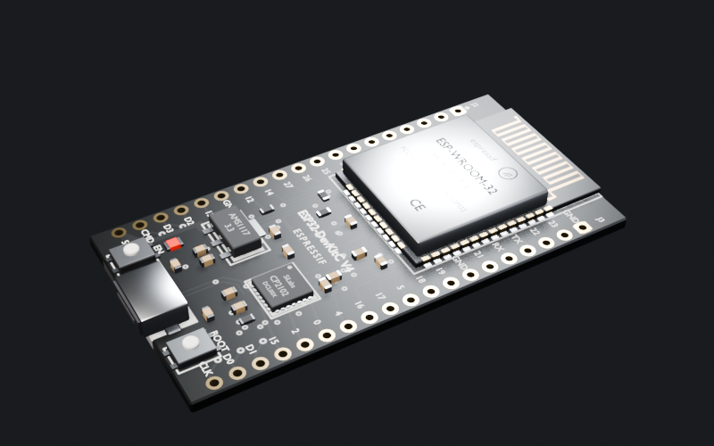
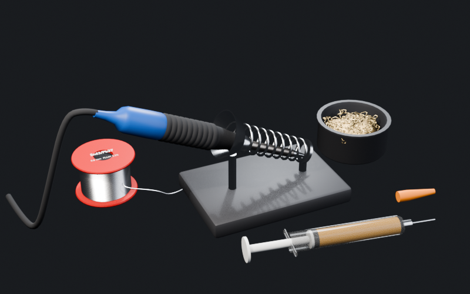

# El armado de verdad · plan (Fase 2)

> Santiago (16-10-2026): *"mejorar es el armado como tal. hacer las partes mejores en Blender o algo y importarlas,
> pero que se vea como una ESP32 de verdad. Que tenga que atornillar o colocar o arrastrar o soldar las cosas. Que
> tenga una guía de conexión aparte y tenga que soldar los cables con un soldador. Y que tenga que prenderlo,
> apagarlo, esperar a que se caliente, usar flux, estaño, limpiar. Conectar la batería, aumentar el riesgo de
> errores. Y así hacerlo muy interactivo."*

Este plan junta eso con lo que ya estaba anotado en la [Fase 2 del roadmap](ROADMAP.md) (soldar, multímetro de verdad,
componentes dañados, diagnóstico) y responde la pregunta de fondo: **¿podemos hacer las piezas?** Sí; la prueba está
en la sección 3.

## 1. Cómo está hoy

El banco (`app/banco.js` la lógica, `app/ui_banco.js` la pantalla) ya tiene los pasos de un armado real: imprimir →
armar → cablear → prueba de humo → firmware → configurar → motores → hélices → prueba atada. La lógica es buena y se
queda: cada pieza es un **componente con pines** de verdad (ESP32, STM32, ExpressLRS…), `revisar()` dice qué se
quema, qué no funciona y qué falta, y las unidades guardan su vida, su firmware y su calibración.

Lo que falta es **el oficio**:

| Hoy | Lo que se siente |
|---|---|
| *Armar* = un botón; cada pieza vuela sola a su lugar | no colocas ni atornillas nada |
| *Cablear* = tocar un pin y otro en un diagrama (SVG) | no hay cautín, ni estaño, ni cables |
| Las piezas en 3D son cajas y cilindros (`dron3d.js`) | una controladora no parece una ESP32 |
| El diagrama de conexión está encima de las piezas | no hay que leer una guía y llevarla a la placa |
| La prueba de humo es un botón | conectar la batería no da miedo |

## 2. La meta: la mesa de trabajo

Una pantalla nueva del banco: **la mesa vista desde arriba y un poco inclinada**, con las piezas de verdad en 3D,
las herramientas a los lados y la guía de conexión en una hoja aparte. Todo se hace con el ratón (o el dedo).

```
┌──────────────────────────────────────────────────────────────────────────────────┐
│  [caja de piezas]          LA MESA (3D)                        [herramientas]   │
│   ESP32  ESC  motores      ┌──────────────┐                     🔥 estación      │
│   tornillos M3 · M2        │  el chasis   │   🔍 lupa (zoom)    🧴 flux           │
│   standoffs · gomas        │  + lo que    │                     🧵 estaño         │
│   cables rojo/negro        │  ya pusiste  │                     🪛 destornillador │
│                            └──────────────┘                     📟 multímetro     │
│  [📄 guía de conexión]  ← una hoja aparte: se abre al costado, no encima           │
│  [🔋 batería]  ← lo último, con miedo                                              │
└──────────────────────────────────────────────────────────────────────────────────┘
```

### 2.1 Colocar y arrastrar
- Arrastras la pieza desde la caja a la mesa. Cerca de su lugar, se ve el **imán** (los agujeros de montaje
  brillan) y encaja.
- **Orientación:** la controladora tiene una flecha; si la pones al revés, el dron vuela loco (error real y común).
  Se gira con la rueda del ratón o con R.
- **Standoffs y gomas** antes de la controladora; sin gomas la vibración baja la nitidez del video (eso ya existe
  en `parts.js` y ahora sale de lo que hiciste).

### 2.2 Atornillar
- Eliges el tornillo de la caja (M3×8, M3×6, M2×5). El equivocado no entra o atraviesa el motor y **toca el
  bobinado** (corto a tierra: un error real que se descubre con el multímetro).
- Con el destornillador, **giras** (arrastrar en círculo o mantener apretado). Una barra muestra el apriete:
  flojo = vibra y se suelta en vuelo; bien; demasiado = rosca pasada o placa rajada.
- Los 4 tornillos de cada motor, los 4 del stack. Se puede apretar "en cruz" para un bono de vibración.

### 2.3 Soldar (el corazón del armado)
La estación de soldar es una herramienta con estado propio:

| Paso | Qué haces | Si te lo saltas |
|---|---|---|
| **Prender** | interruptor + elegir temperatura (300-420 °C) | — |
| **Esperar** | la punta sube de temperatura en tiempo real (≈ 20 s, acelerado) y cambia de color | soldar en frío = **soldadura fría** |
| **Limpiar** | la punta en la viruta de bronce o la esponja húmeda | punta oxidada: transmite menos calor |
| **Estañar la punta** | tocar el estaño con la punta | idem |
| **Flux** | una gota en el pad (la jeringa) | el estaño no "moja": fría o bola |
| **Estañar pad y cable** | punta en el pad + estaño; el cable pelado también | junta débil |
| **Unir** | cable sobre el pad, punta encima 1-3 s, retirar | — |
| **Apagar** | al terminar (o se queda prendida en la mesa) | la punta se gasta (dura menos) |

Cada junta tiene un **resultado** que el juego guarda y usa después:
- **Buena** (brillante, cónica).
- **Fría** (opaca, granulosa): funciona en el banco y **falla en vuelo por vibración** → el motor se apaga, el dron cae.
- **Puente** (estaño de más entre dos pads vecinos): **corto**. En los pads de la ESP32 (2,54 mm) pasa poco; en los
  del ESC de 30 A, con pads grandes, pasa si echas mucho.
- **Pad levantado** (mucho calor o mucho tiempo): hay que puentear con un cablecito a otro punto.
- **Componente quemado** (calor de más en un pin de un chip, o soldar con la batería conectada).

El minijuego es corto (≈ 5-8 s por junta) para que 20 juntas no aburran, y tiene **modo rápido** cuando ya
compraste una estación buena y tienes práctica (las juntas fáciles se hacen solas con su probabilidad de salir bien).

### 2.4 Cables
- Un cable sale del carrete (rojo, negro, colores de señal), lo **cortas a medida** (corto = no llega; largo = se
  enreda con la hélice y se corta en vuelo) y lo **pelas** (de más = el cobre toca el pad vecino).
- **Calibre:** el de la batería tiene que ser grueso (14-16 AWG); uno fino se calienta y se derrite con el gas a fondo.

### 2.5 La guía de conexión, aparte
- Una hoja (como el PDF del fabricante) que se abre al costado con el **pinout** de cada placa y qué va con qué.
  Ya existe la información: `banco.js manual()`.
- En la mesa **no se dibujan las líneas** encima: miras la guía, encuentras el pad en la placa (con la lupa) y
  sueldas. Ese es el reto.
- **Modo guía** (opcional, para empezar o para quien no quiere sufrir): el pad que toca brilla.

### 2.6 Conectar la batería (con riesgo)
- Antes: el **multímetro** en continuidad entre + y − del XT60 (pita = corto: **no conectes**).
- Herramienta nueva: **smoke stopper** (un fusible que corta si hay corto; salva las piezas una vez).
- Conectar es arrastrar el XT60 macho al hembra: la chispa, el pitido de los motores (las notas del ESC) o el humo.
- La batería al revés (en conectores sin forma) o soldar con la batería conectada → se quema algo.

### 2.7 Más riesgo, pero justo
Todos los errores **se pueden prevenir o diagnosticar** con una herramienta (multímetro, lupa, la guía), y el juego
**dice qué pasó** después (como hoy `revisar()`): "el motor 3 se apagó en vuelo: soldadura fría en el cable B".
Las piezas quemadas cuestan plata; la reputación no se pierde por un error en el banco.

## 3. Las piezas en 3D: sí se puede (prueba hecha)

**Cómo:** cada pieza es un **script de Python para Blender** (`blender/piezas/*.py`), no un modelo a mano. Así:
- vive en git (se revisa y se cambia como código), se rehace igual cada vez y no hace falta saber modelar;
- tiene **medidas reales** (la ESP32 DevKit mide 51 × 28 mm; el juego usa metros);
- cada parte que importa tiene **nombre**: `pad_GPIO23`, `pad_GND_1`, `punta` (la del cautín)… El juego las encuentra
  por nombre para saber dónde soldar, qué brilla o qué se calienta.

**El camino:** Blender (sin ventana, `-b --python`) → `app/modelos/<pieza>.glb` → el juego la carga con `GLTFLoader`
(three.js r169, vendorizado en `game/vendor/loaders/`). Si un GLB falta, el juego usa la forma simple de hoy
(`dron3d.js`), así nada se rompe a medias.

**La prueba (16-10-2026):** dos piezas hechas solo con código, de punta a punta (Blender → GLB → el navegador).

| ESP32 DevKitC V4 (`esp32_devkit.py`) | Estación de soldar (`soldador.py`) |
|---|---|
|  |  |

- **ESP32 DevKitC V4** a medida real (54,4 × 27,9 × 1,6 mm): placa negra (o verde con `color="verde"`), módulo
  ESP-WROOM-32 con su blindaje y textos, la antena de cobre en zigzag, micro-USB, CP2102, AMS1117, botones EN y
  BOOT, LED rojo, 17 componentes chicos, serigrafía con el nombre de cada pin y **38 pads con nombre**
  (`pad_GPIO23`, `pad_GND_1`, `pad_5V`…). Cada pad trae `{fila, n, pin, etiqueta}`, que en three.js llega como
  `userData`: al hacer clic en uno, el juego sabe que es el GPIO23 de la fila J3.
- **Estación de soldar:** base con resorte, cautín (mango, grip, vástago y `punta`, que se puede poner al rojo),
  cable, limpiador de viruta de bronce, jeringa de flux con su tapa y carrete de estaño Sn63/Pb37.
- **Números:** ESP32 709 KB y 14.607 triángulos; soldador 783 KB y 29.081 triángulos. Blender las arma y exporta en
  **menos de 1 s cada una** (≈ 1,5 s las dos, sin ventana); en el navegador la ESP32 carga en ≈ 130 ms.
- **Para verlas:** http://localhost:8765/app/piezas.html (página de desarrollo, no está en el juego): girar, clic en
  una pieza para ver su nombre, "punta caliente".
- **Rehacerlas:** `/Applications/Blender.app/Contents/MacOS/Blender -b --factory-startup --python
  blender/piezas/exportar_todo.py` (`-- esp32_devkitc` para una sola, `-- --sin-render` sin las imágenes).
  Las ayudas comunes (materiales de PCB, oro, estaño, textos planos, pintar la textura de la placa con pistas y
  vías, exportar, renderizar) están en `blender/piezas/lib_piezas.py`: cada pieza nueva es un script corto.
- **Por mejorar:** en el navegador el blindaje refleja demasiado el ambiente (se ve azulado); el cable del cautín es
  algo rígido; el logo de Espressif es aproximado. Son ajustes de material, no de método.

### Lista de piezas, por prioridad

| Prioridad | Pieza | Lo que tiene que tener |
|---|---|---|
| 1 | ESP32 DevKit (controladora básica) | ✅ prototipo · pads con nombre, escudo, antena, USB, botones |
| 1 | Estación de soldar, flux, estaño, limpiador | ✅ prototipo · `punta` que se pone roja |
| 1 | ESC 4 en 1 (30 A) | pads grandes de batería y motores, MOSFETs, capacitor |
| 1 | Motor brushless (1806 / 2204 / 2306) | campana, 3 cables, 4 agujeros M2/M3 |
| 1 | Chasis de madera y su versión impresa | agujeros de montaje con nombre (`m_FL`, `stack_1`…) |
| 2 | Batería LiPo + XT60 macho/hembra | cables gruesos, etiqueta con S y mAh |
| 2 | Receptor ExpressLRS + antena | pads 5V/GND/TX/RX, U.FL |
| 2 | Cámara (juguete / FPV / cine) | lente, soporte |
| 2 | Tornillos, standoffs, gomas | instanciados (muchos y livianos) |
| 3 | STM32 F405 / F722 / H743 | las otras controladoras (mismo script, otro pinout) |
| 3 | Multímetro, destornillador, lupa, tercera mano | herramientas de la mesa |
| 3 | Hélices, protectores, GPS, ToF, LED | lo demás |

Presupuesto: ≤ 1,5 MB por pieza, ≤ 15 MB todo el banco (se carga solo al abrir el banco, con caché).

## 4. Cómo se programa (para quien programa)

- **`banco.js` sigue siendo la verdad**: pines, cables, `revisar()`. Un cable nuevo se agrega igual que hoy, pero
  ahora trae su **calidad** (las juntas de sus dos puntas).
- **`soldadura.js`** (nuevo, sin pantalla, con `test_soldadura.mjs`): la estación (temperatura que sube y baja con
  el tiempo, punta limpia/oxidada, encendida) y cada junta: `{ pad, cable, flux, estano, energia, tiempo }` →
  `buena | fria | puente | pad_levantado | quemado`. Las mismas cuentas siempre; el azar con semilla.
  - Modelo simple: la energía de la junta es ∫ (T_punta − 230 °C) dt con la punta tocando; hay una ventana buena
    que depende del pad (chico/grande) y de la limpieza y el flux. Poca energía → fría; mucha → pad levantado o
    chip quemado. Estaño de más en pads a menos de 3 mm → puente.
- **`atornillar.js`** (nuevo, sin pantalla): tornillo correcto/incorrecto, apriete → vibración o daño.
- **`piezas3d.js`** (nuevo): carga y guarda en caché los GLB; da los nodos por nombre; si falta, la forma de hoy.
- **`mesa.js`** (nuevo): la escena de la mesa, la cámara, el ratón (raycast a los pads), arrastrar con imanes, el
  cautín que sigue al ratón, la lupa.
- `piezas.json` gana `modelo` (el GLB) y `pads` (pin de `banco.js` → nombre del nodo en el GLB) por pieza.
- **La partida guarda** las juntas y los tornillos de cada dron (`d.banco.juntas`, `d.banco.tornillos`). Una partida
  vieja sin eso se toma como "soldado bien" (no se rompe nada).
- **Vuelo:** una junta fría tiene una probabilidad por minuto de vuelo de soltarse (sale en `mision_sim.js`, así la
  flota también la sufre); un tornillo flojo suma vibración.
- i18n: todo con `t()` como siempre.

## 5. Por partes (cada una se puede jugar sola)

| Parte | Qué trae | Depende de |
|---|---|---|
| **2a · Las piezas** | los GLB de prioridad 1 y 2, `piezas3d.js`; el banco y el garaje de hoy ya las muestran | — |
| **2b · La mesa** | la vista de la mesa, arrastrar y colocar con imanes, orientación, la guía aparte | 2a |
| **2c · Soldar** | la estación, flux, estaño, limpiar; juntas con resultado; cables a medida | 2b |
| **2d · Atornillar** | tornillos, destornillador, apriete | 2b |
| **2e · La batería y el multímetro** | continuidad/voltaje/resistencia en la mesa, smoke stopper, conectar con riesgo | 2c |
| **2f · Componentes dañados y diagnóstico** | piezas malas de fábrica, síntomas en vuelo, el reporte "por qué cayó" | 2c-2e |

Recomendado empezar por **2a + 2b**: se ve el cambio enseguida (las piezas reales en la mesa) y ordena todo lo demás.

## 6. Riesgos

- **Que aburra:** 20 juntas × 8 s está bien; × 30 s no. Por eso juntas cortas, modo rápido con práctica y la
  estación buena como mejora que se compra.
- **Que frustre:** todo error se puede ver venir (multímetro, lupa) y el juego explica qué pasó. Modo guía opcional.
- **Rendimiento:** pocas piezas en pantalla, polígonos moderados, tornillos instanciados. Probar en un portátil.
- **El celular** (la app futura): la mesa necesita precisión; con el dedo, la lupa se abre sola al tocar cerca de los pads.
