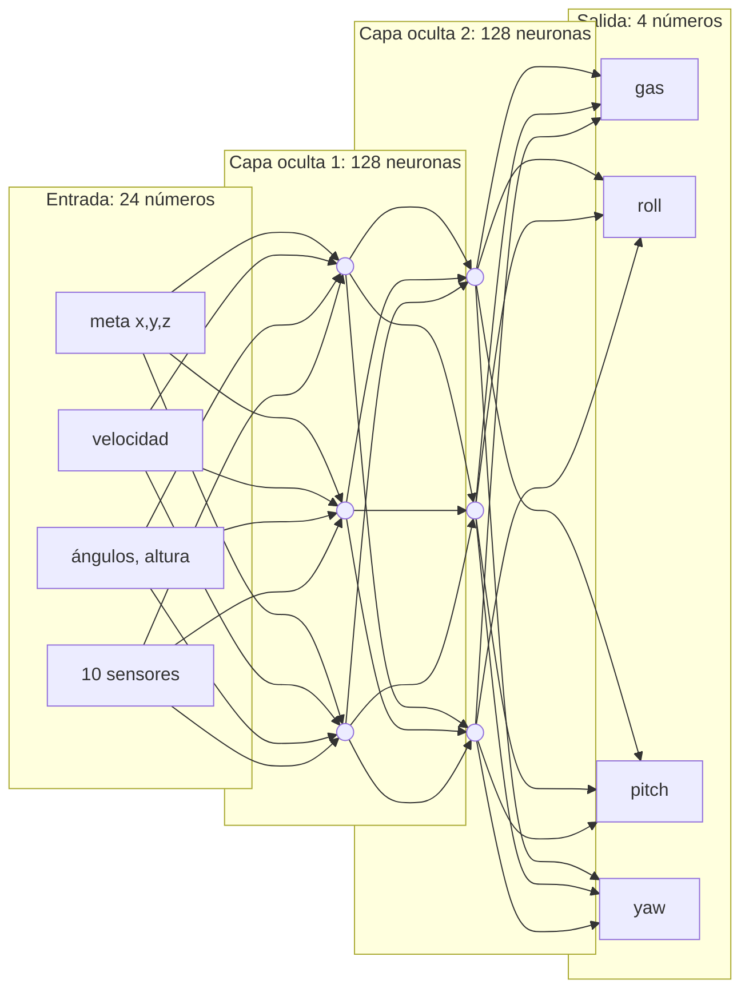
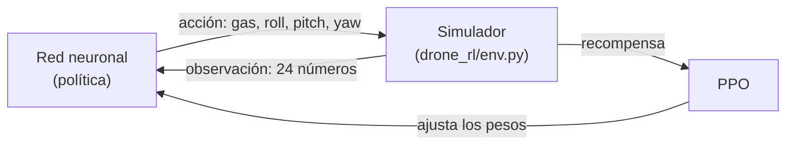

# Redes neuronales: qué son y cómo funcionan

Guía práctica para este proyecto. Cada idea tiene su código en
[`learn/red_neuronal_desde_cero.py`](../learn/red_neuronal_desde_cero.py), escrito solo con numpy
para que se vea cada cuenta. Córrelo mientras lees:

```bash
python learn/red_neuronal_desde_cero.py --parte 1   # una neurona
python learn/red_neuronal_desde_cero.py --parte 2   # XOR + chequeo de gradiente
python learn/red_neuronal_desde_cero.py --parte 3   # ver una red aprender una forma
python learn/red_neuronal_desde_cero.py --parte 4   # la red aprende a volar el dron
```

---

## 1. La idea en una frase

Una red neuronal es una **función con miles de perillas** (los *pesos*). Entrenarla es girar
esas perillas, poquito a poco, hasta que la función haga lo que queremos.

En este proyecto, esa función recibe 24 números (lo que "siente" el dron) y devuelve 4
(gas, roll, pitch, yaw).

## 2. Una neurona

Una neurona hace dos cosas:

1. **Suma ponderada**: multiplica cada entrada por su peso, suma todo y le agrega un sesgo.
2. **Activación**: pasa el resultado por una curva no lineal.

$$z = x_1 w_1 + x_2 w_2 + x_3 w_3 + b \qquad y = \tanh(z)$$

Ejemplo (parte 1 del script): con `x = [0.5, -1, 2]`, `w = [0.8, 0.2, -0.5]` y `b = 0.1`:

```
z = 0.5·0.8 + (-1)·0.2 + 2·(-0.5) + 0.1 = -0.70
y = tanh(-0.70) = -0.604
```

Si te sirve una analogía de embebidos: los pesos son como las ganancias de un controlador. Un
peso grande significa que esa entrada importa mucho, y un peso negativo que la entrada empuja
en contra.

## 3. ¿Por qué la activación?

Sin la curva, apilar neuronas solo daría otra suma ponderada, o sea una línea recta. La activación
es lo que permite aprender cosas curvas.

| Activación | Fórmula | Rango | Dónde se usa aquí |
|---|---|---|---|
| tanh | $\tanh(z)$ | -1 a 1 | capas ocultas (y la usa PPO por defecto) |
| sigmoid | $1/(1+e^{-z})$ | 0 a 1 | salida de "sí/no" (XOR, anillo) |
| ReLU | $\max(0, z)$ | 0 a ∞ | la más común en visión; no la usamos |

## 4. Capas: de neurona a red

Las neuronas se agrupan en **capas**, y cada capa alimenta a la siguiente. Esto se llama
*MLP* (perceptrón multicapa) o red densa.



En código, una capa entera es una multiplicación de matrices: `y = x @ W + b`.
La red del dron (24 → 128 → 128 → 4) tiene unos 20 000 pesos.

**¿Para qué más de una capa?** La parte 2 lo muestra con XOR (`0,0→0` · `0,1→1` · `1,0→1` · `1,1→0`).
Ninguna línea recta separa los 1 de los 0, así que una neurona sola no puede. Con una capa oculta de
4 neuronas, la red lo resuelve:

```
época    0  pérdida 0.2469   predicciones [0.5  0.56 0.48 0.53]
época  100  pérdida 0.0022   predicciones [0.01 0.96 0.95 0.06]
época 2000  pérdida 0.0000   predicciones [0.   1.   1.   0.01]
```

## 5. Cómo aprende: pérdida + descenso de gradiente

1. **Forward**: le das una entrada y la red calcula una salida.
2. **Pérdida** (*loss*): un número que mide qué tan mal estuvo. Aquí usamos el error cuadrático
   medio, `mean((predicción - correcto)²)`.
3. **Gradiente**: para *cada* peso, calculas cuánto subiría la pérdida si lo movieras un poquito.
4. **Paso**: mueves cada peso en la dirección contraria, para que la pérdida baje.

```
peso_nuevo = peso - learning_rate × gradiente
```

Una analogía: estás en una montaña con niebla y quieres bajar al valle. No ves el valle, pero
sí sientes la pendiente bajo tus pies. Das un paso hacia abajo y repites. El *learning rate* es el
tamaño del paso: si es muy grande te pasas de largo, y si es muy chico tardas una eternidad.

## 6. Backpropagation (la regla de la cadena)

¿Cómo se calcula el gradiente de 20 000 pesos sin probar uno por uno? Con la **regla de la cadena**.
Se empieza por el error al final y se va "propagando hacia atrás", capa por capa.

Ejemplo a mano con una neurona sin activación: `y = w·x + b`, pérdida `L = (y - t)²`.
Con `x = 2`, `w = 0.5`, `b = 0` y valor correcto `t = 3`:

| Paso | Cuenta | Valor |
|---|---|---|
| forward | y = 0.5·2 + 0 | 1.0 |
| pérdida | L = (1 - 3)² | 4.0 |
| dL/dy | 2(y - t) | -4 |
| dL/dw | dL/dy · x | -8 |
| dL/db | dL/dy · 1 | -4 |
| paso (lr = 0.05) | w = 0.5 + 0.4,  b = 0 + 0.2 | w = 0.9, b = 0.2 |
| forward de nuevo | y = 0.9·2 + 0.2 | 2.0 → pérdida 1.0 |

En una sola iteración la pérdida bajó de 4 a 1. Una red grande hace exactamente esto, solo que con
matrices. En el script, cada capa tiene un `backward()` de 2 o 3 líneas.

**Cómo saber si el backprop está bien:** la parte 2 compara el gradiente calculado con una
aproximación numérica, `(L(w+ε) - L(w-ε)) / 2ε`. Si los dos coinciden, el código está correcto:

```
chequeo de gradiente: backprop -0.005176  vs  numérico -0.005176
```

## 7. Entrenar en la práctica

- **Mini-lotes** (*batches*): en vez de usar todos los datos en cada paso, se usan 128 o 256 al azar.
  Es más rápido y el ruido ayuda a no quedarse atascado.
- **Época**: una pasada por los datos.
- **Adam**: el optimizador que usamos. Es descenso de gradiente con "inercia" (recuerda la dirección
  de los pasos anteriores) y con un tamaño de paso propio para cada peso.
- **Sobreajuste** (*overfitting*): la red memoriza los ejemplos en vez de aprender la regla. Se
  detecta probando con datos que nunca vio. Por eso la parte 4 evalúa con semillas distintas.

La parte 3 lo hace visible: una red de 337 pesos aprende a reconocer un anillo y la terminal la
dibuja en la época 0, en la 300 y en la 3000. Llega a 98.7 % de precisión.

## 8. Dos formas de enseñarle a volar

| | Supervisado (imitación) | Refuerzo (PPO) |
|---|---|---|
| Qué necesita | un experto que muestre qué hacer | solo una recompensa |
| Cómo aprende | "en esta situación el experto hizo X: copia X" | prueba, mira si le fue bien, repite lo que funcionó |
| Techo | lo mismo que el experto | puede superarlo |
| En este repo | `learn/` parte 4 | `scripts/train.py` |

La **parte 4** usa la red hecha a mano para copiar al piloto PD (`drone_rl/controller.py`) y logra
llegar a metas aleatorias el 100 % de las veces. Pero el piloto PD no sabe esquivar columnas, así
que una copia tampoco va a saber. Para eso hace falta refuerzo.

## 9. Aprendizaje por refuerzo y PPO



**La recompensa** (en `env.py`) es lo único que le dice a la IA qué queremos:

| Evento | Recompensa |
|---|---|
| acercarse a la meta | +2 por metro |
| llegar a la meta | +10 |
| chocar (piso, obstáculo o salir del área) | -10, y termina el episodio |
| cada paso que pasa | -0.01 (el tiempo cuesta) |
| movimientos bruscos o mucha inclinación | castigo pequeño |
| (solo en hover) estar cerca de la meta | premio continuo |

Diseñar la recompensa es la mitad del trabajo. Si está mal hecha, la IA encuentra "trampas": en la
primera prueba de este proyecto aprendió que quedarse en el suelo era más seguro que intentar
volar. Eso está documentado en el README.

**PPO usa dos redes:**
- **Actor (política)**: 24 → 128 → 128 → 4. Da la acción *promedio*, y PPO le suma un poco de ruido
  para explorar. Ese ruido se va reduciendo a medida que la IA se vuelve más segura.
- **Crítico (valor)**: 24 → 128 → 128 → 1. Estima "cuánta recompensa espero desde aquí". Sirve para
  juzgar si una acción fue *mejor o peor de lo esperado*. Esa diferencia se llama la **ventaja**.

**El ciclo de PPO:**
1. Los 8 drones vuelan 1024 pasos cada uno con la política actual, y se guarda todo.
2. Para cada acción se calcula la ventaja: ¿salió mejor o peor de lo que el crítico esperaba?
3. Se ajusta el actor para que las acciones con ventaja positiva sean más probables y las negativas
   menos probables, **pero con un límite** (el *clip* de ±20 %). Así un solo lote de datos no puede
   cambiar la política de golpe. De ahí viene el nombre: *Proximal* Policy Optimization.
4. Se ajusta el crítico para que prediga mejor.
5. Se repite. Son cientos de miles de pasos, que el simulador hace en minutos.

**Currículum:** se empieza por lo fácil (hover) y cada nivel arranca con los pesos del anterior.
Es como aprender a volar en la vida real: nadie empieza haciendo freestyle.

## 10. Glosario rápido

| Término | Qué es |
|---|---|
| peso / sesgo | las "perillas" de la red |
| forward | calcular la salida |
| loss / pérdida | qué tan mal estuvo |
| gradiente | hacia dónde moverse para bajar la pérdida |
| backprop | calcular todos los gradientes con la regla de la cadena |
| learning rate | tamaño del paso |
| época / batch | una pasada por los datos / un grupito de ejemplos |
| política | la red que decide la acción |
| recompensa | la señal de "bien / mal" en refuerzo |
| episodio | un intento completo (hasta llegar, chocar o acabar el tiempo) |
